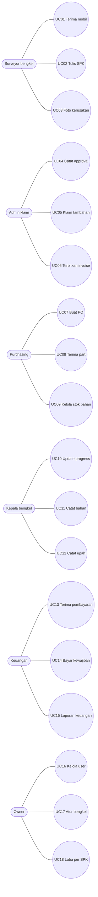
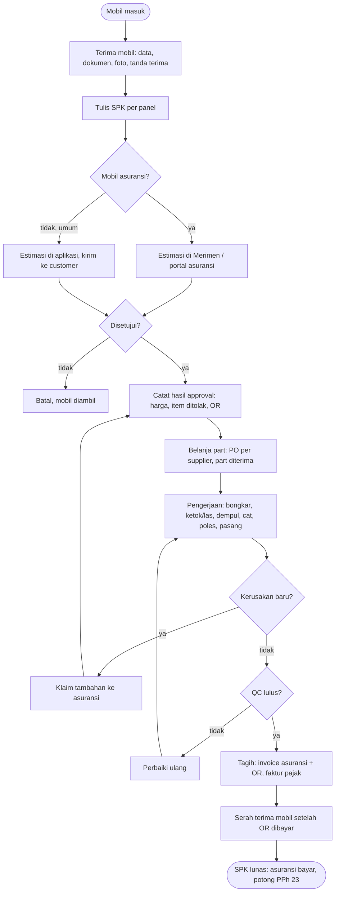
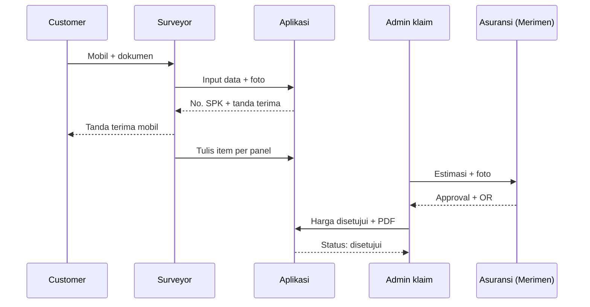
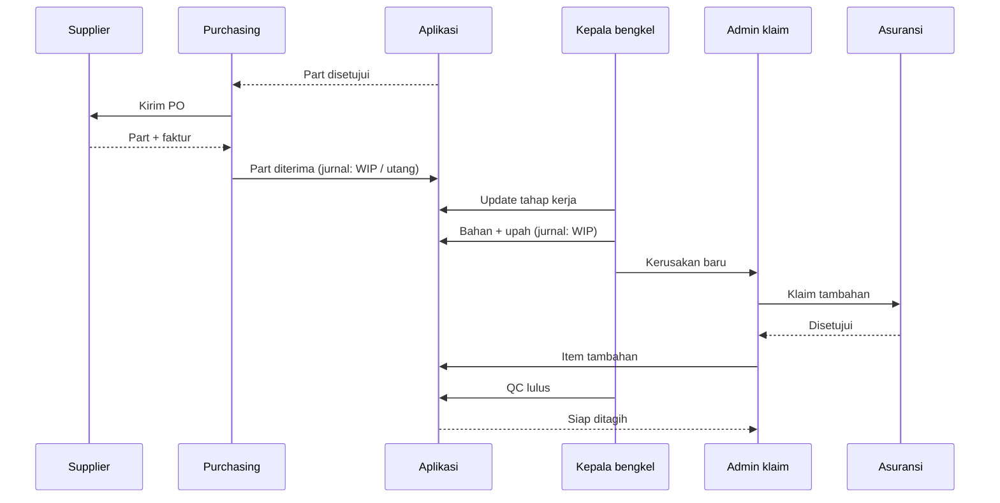
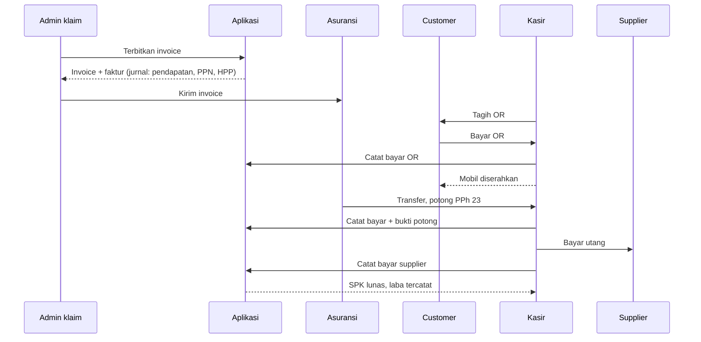
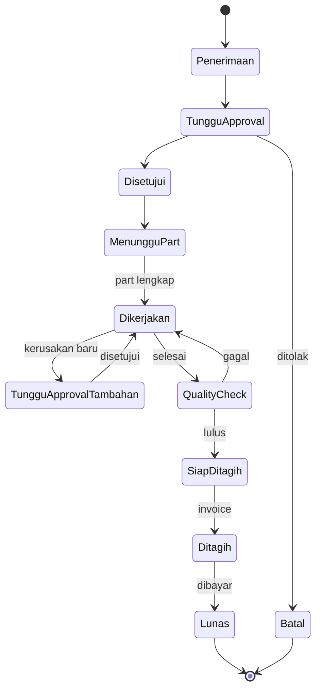
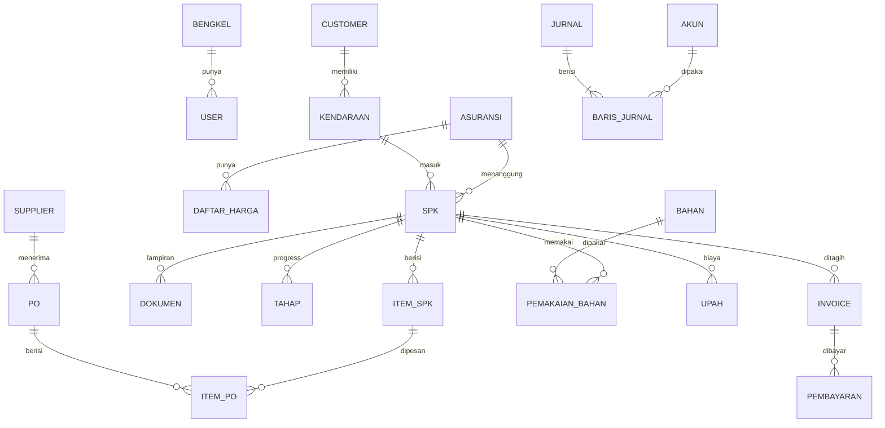

# Dokumentasi Sistem Manajemen Bengkel Body & Cat

> Per 27 Nov 2026 · Status: draft.
> Versi yang lebih nyaman dibaca (dengan diagram rapi, bisa dikomentari dan diekspor ke Word/PDF): https://claude.ai/artifact/CxjhH6CjH7j2ZyrWgh9QuZ
> File ini salinan di repo. Diagram memakai Mermaid (tampil otomatis di GitHub).
> Terkait: [BREAKDOWN.md](BREAKDOWN.md) (ringkasan keputusan) · [DISKUSI.md](DISKUSI.md) (catatan diskusi)

---

## 1. Ringkasan

Sistem internal bengkel body & cat rekanan asuransi: mobil masuk → SPK → belanja part → pengerjaan → tagihan → laporan keuangan, dengan jurnal akuntansi otomatis. Direncanakan dijual sebagai SaaS ke bengkel lain, mulai dari Medan.

**Masalah yang diselesaikan**
- Pencatatan manual (Excel): laba per mobil dan nilai stok sulit diketahui.
- Part dibeli setelah klaim disetujui, dari supplier berbeda-beda, sering tidak terhubung ke mobilnya.
- Piutang asuransi cair 30–90 hari dan mudah terlewat.
- PPN (bengkel PKP) dan PPh 23 yang dipotong asuransi perlu dicatat rapi.

| Termasuk | Tidak termasuk |
|---|---|
| Penerimaan mobil, tanda terima, SPK per panel | Pengajuan klaim ke asuransi (tetap lewat Merimen/portal) |
| Catat approval, klaim tambahan | Penggajian lengkap (hanya upah tukang per SPK) |
| PO per supplier, penerimaan part, stok bahan | Pelaporan pajak ke DJP (aplikasi menyiapkan datanya) |
| Progress pengerjaan, upah tukang | |
| Invoice, piutang, utang, jurnal otomatis, laporan | |
| Multi-tenant (banyak bengkel) | |

## 2. Posisi terhadap Merimen

Aplikasi tidak menggantikan Merimen. Merimen = komunikasi dengan asuransi; aplikasi = semua urusan di dalam bengkel.

| Urusan | Merimen | Aplikasi |
|---|---|---|
| Ajukan estimasi, dapat approval, klaim tambahan | Ya | Mencatat hasilnya |
| Tanda terima, SPK kerja, PO, stok, progress, upah | Tidak | Ya |
| Invoice, piutang, utang, PPN/PPh, laporan, laba | Tidak | Ya |
| Mobil umum & asuransi non-Merimen | Tidak | Ya |

Alur tanpa ketik dua kali: surveyor tulis SPK di aplikasi → estimator input ke Merimen → admin klaim catat harga disetujui + upload PDF approval. Import otomatis bila Merimen bisa ekspor (belum dicek).

## 3. Aktor & role

| Role | Tugas | Harga beli | Harga jual | Laporan keuangan |
|---|---|---|---|---|
| Surveyor bengkel | Terima mobil, tanda terima, tulis SPK, foto | – | – | – |
| Admin klaim / estimator | Catat approval, klaim tambahan, invoice | – | ✓ | – |
| Admin gudang / purchasing | PO, terima part, stok bahan | ✓ | – | – |
| Kepala bengkel | Progress, tugaskan tukang, bahan, upah | – | – | – |
| Keuangan / kasir | Pembayaran, bayar supplier & upah, laporan | ✓ | ✓ | ✓ |
| Owner | Semua + pengaturan + kelola user | ✓ | ✓ | ✓ |

Pihak luar (tidak login): customer, asuransi, supplier. Role platform SaaS: admin platform.

## 4. Use case

| ID | Use case | Aktor | Pihak luar | Hasil |
|---|---|---|---|---|
| UC01 | Terima mobil | Surveyor | Customer | Data mobil, asuransi, dokumen; tanda terima |
| UC02 | Tulis SPK | Surveyor | – | Item per panel + jenis pekerjaan; SPK kerja tanpa harga |
| UC03 | Foto kerusakan | Surveyor | – | Foto per panel |
| UC04 | Catat approval | Admin klaim | Asuransi | Harga disetujui, item ditolak, OR, PDF approval |
| UC05 | Klaim tambahan | Admin klaim | Asuransi | Item baru menunggu → disetujui/ditolak |
| UC06 | Terbitkan invoice | Admin klaim | Asuransi, customer | Invoice + OR, faktur; jurnal pendapatan & HPP |
| UC07 | Buat PO | Purchasing | Supplier | PO per supplier |
| UC08 | Terima part | Purchasing | Supplier | Part ke SPK; jurnal biaya & utang |
| UC09 | Kelola stok bahan | Purchasing | Supplier | Stok & harga rata-rata |
| UC10 | Update progress | Kepala bengkel | – | Tahap bongkar–QC |
| UC11 | Catat bahan | Kepala bengkel | – | Stok berkurang, biaya ke SPK |
| UC12 | Catat upah | Kepala bengkel | – | Upah per SPK |
| UC13 | Terima pembayaran | Keuangan | Asuransi, customer | Piutang lunas, PPh 23 tercatat |
| UC14 | Bayar kewajiban | Keuangan | Supplier, tukang | Utang lunas |
| UC15 | Laporan keuangan | Keuangan | – | Laba rugi, neraca, umur piutang, PPN |
| UC16 | Kelola user | Owner | – | User, role |
| UC17 | Atur bengkel | Owner | – | Asuransi, harga, supplier, pajak, nomor dokumen |
| UC18 | Laba per SPK | Owner | – | Pendapatan, HPP, margin |

## 5. Flowchart alur kerja

## 6. Sequence diagram

**1. Penerimaan sampai approval**

**2. Belanja part, pengerjaan, klaim tambahan**

**3. Penagihan dan pembayaran**

## 7. Status SPK

| Status | Arti | Diubah oleh |
|---|---|---|
| Penerimaan | Mobil diterima, SPK ditulis | Surveyor |
| Tunggu approval | Estimasi diajukan | Admin klaim |
| Batal | Ditolak seluruhnya | Admin klaim |
| Disetujui | Approval tercatat | Admin klaim |
| Menunggu part | PO terkirim, part belum lengkap | Purchasing |
| Dikerjakan | Pengerjaan berjalan | Kepala bengkel |
| Tunggu approval tambahan | Klaim tambahan diajukan | Admin klaim |
| Quality check | Menunggu QC | Kepala bengkel |
| Siap ditagih | QC lulus | Kepala bengkel |
| Ditagih | Invoice terbit | Admin klaim |
| Lunas | Semua pembayaran masuk | Keuangan |

## 8. Model data (ERD)

Semua tabel menyimpan `bengkel_id` (multi-tenant).

| Tabel | Kolom utama |
|---|---|
| Bengkel | nama, alamat, NPWP, PKP, logo, rekening, paket |
| User | nama, email/HP, role, aktif |
| Customer | nama, no. HP, alamat |
| Kendaraan | no. polisi, merek, tipe, tahun, warna, no. rangka |
| Asuransi | nama, pakai Merimen, tempo bayar |
| Daftar harga jasa | asuransi, panel, jenis pekerjaan, harga |
| SPK | no. SPK, kendaraan, jenis, asuransi, no. polis, no. klaim, own risk, status, tgl masuk/keluar |
| Item SPK | panel, jenis pekerjaan, harga estimasi, harga disetujui, status, tambahan |
| Revisi SPK | item, nilai lama/baru, alasan, user, waktu |
| Dokumen & foto | SPK, jenis, file |
| Tahap pengerjaan | SPK, tahap, selesai, user, waktu |
| Supplier | nama, PKP, NPWP, tempo, kontak |
| PO / Item PO | supplier, SPK, status / item SPK, harga beli, PPN |
| Bahan / Pembelian / Pemakaian | stok & harga rata-rata / qty, harga / SPK, qty, nilai |
| Upah | SPK, tukang, jumlah, dibayar |
| Invoice / Pembayaran | tujuan, DPP, PPN, no. faktur / jumlah, PPh 23, tanggal |
| Akun / Jurnal | kode, nama, kelompok / tanggal, sumber, debit, kredit |

## 9. Akuntansi

| Kejadian | Debit | Kredit |
|---|---|---|
| Beli bahan stok | Persediaan Bahan, PPN Masukan | Kas/Bank atau Utang Supplier |
| Part SPK diterima | Pekerjaan Dalam Proses, PPN Masukan | Kas/Bank atau Utang Supplier |
| Bahan dipakai | Pekerjaan Dalam Proses | Persediaan Bahan |
| Upah tukang | Pekerjaan Dalam Proses | Utang Upah |
| Invoice terbit | Piutang Asuransi, Piutang Customer | Pendapatan Jasa, Pendapatan Part, PPN Keluaran |
| Invoice terbit (penutup) | HPP | Pekerjaan Dalam Proses |
| Customer bayar OR | Kas/Bank | Piutang Customer |
| Asuransi bayar | Kas/Bank, PPh 23 Dibayar Dimuka | Piutang Asuransi |
| Bayar supplier / upah | Utang Supplier / Utang Upah | Kas/Bank |
| Biaya operasional | Beban | Kas/Bank |

Contoh prototype (data contoh): pendapatan Rp 7.335.000, HPP Rp 4.646.500, laba kotor Rp 2.688.500 (36,7%).
Pajak (konfirmasi konsultan): PPN 11% di prototype (bisa diatur), PPh 23 2% atas jasa, perlakuan PPN atas OR.
Laporan: laba rugi, neraca, arus kas, buku besar, laba per SPK/asuransi, umur piutang, utang jatuh tempo, rekap PPN, ekspor Excel.

## 10. Dokumen & aturan bisnis

| Dokumen | Untuk |
|---|---|
| Tanda terima mobil | Customer |
| Estimasi / penawaran | Asuransi non-Merimen, customer umum |
| SPK kerja (tanpa harga) | Tukang |
| Purchase Order | Supplier |
| Invoice + faktur pajak | Asuransi, customer (OR) |
| Kuitansi | Customer |

1. Satu mobil masuk = satu SPK, nomor otomatis per bengkel.
2. SPK asuransi wajib nama asuransi + nomor klaim.
3. Hanya item disetujui yang masuk PO dan invoice.
4. Part per SPK langsung biaya SPK, tidak masuk stok gudang.
5. Bahan hanya bisa dipakai bila stok cukup; nilai rata-rata tertimbang.
6. Klaim tambahan menunda "siap ditagih".
7. Tagih hanya bila semua tahap selesai dan QC lulus.
8. Invoice asuransi = total disetujui − OR + PPN; OR ditagih ke customer.
9. Selisih bayar karena PPh 23 dicatat sebagai PPh 23 Dibayar Dimuka.
10. Mobil diserahkan setelah OR lunas (owner bisa override).
11. Perubahan setelah approval disimpan sebagai revisi (siapa, kapan).
12. Transaksi terjurnal tidak dihapus; koreksi dengan jurnal pembalik.

## 11. Non-fungsional & SaaS

| Aspek | Kebutuhan |
|---|---|
| Perangkat | PWA: Android, iPhone, komputer |
| Koneksi | Tetap bisa lihat data saat sinyal lemah; sinkron saat online |
| Keamanan | Login per user, hak akses per role, HTTPS |
| Pemisahan data | Data tiap bengkel terpisah total |
| Audit | Perubahan harga/item/transaksi tercatat siapa & kapan |
| Backup | Harian otomatis; ekspor Excel |
| Privasi | Sesuai UU Pelindungan Data Pribadi |
| Format | Bahasa Indonesia, Rupiah, tanggal Indonesia |

Model langganan usulan: Starter (±30 SPK/bln, 3 user), Pro (±100 SPK/bln, 8 user, + akuntansi), Bisnis (tak terbatas, multi-cabang, import Merimen). Harga ditentukan setelah wawancara 5–10 bengkel di Medan.

## 12. Roadmap

1. ✅ Fase 1 & prototype.
2. Tahap A, inti: multi-tenant, login & role, sinkron, penerimaan & tanda terima, SPK, approval, status, PO, stok bahan. Selesai bila bengkel owner menjalankan semua mobil lewat aplikasi selama 1 bulan.
3. Tahap B, keuangan: invoice, piutang, utang, jurnal, laporan. Selesai bila laporan cocok dengan rekap Excel.
4. Tahap C, operasional: upah, progress, klaim tambahan, foto & dokumen, cetak.
5. Tahap D, laporan & integrasi Merimen.
6. Peluncuran SaaS: pilot 3–5 bengkel Medan, harga, pembayaran langganan.

Paralel: wawancara bengkel, badan usaha, merek, syarat layanan, repo privat + hosting baru.

## 13. Pertanyaan terbuka

Lihat daftar lengkap di [BREAKDOWN.md §9](BREAKDOWN.md#9-pertanyaan-terbuka).
